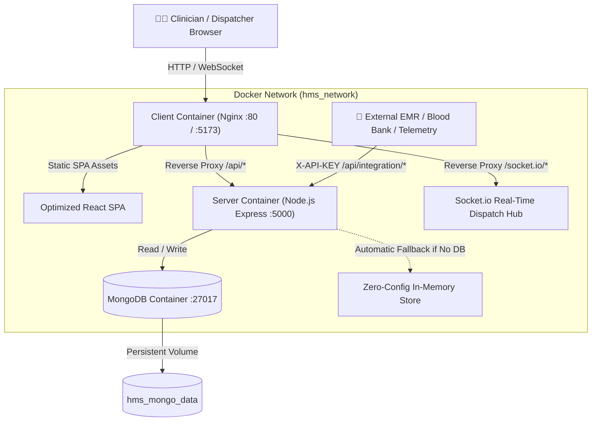

# 🏥 Mayo Emergency Resource Coordination System (HERCS)

[](https://www.docker.com/)
[](https://docs.docker.com/compose/)
[](https://react.dev/)
[](https://vitejs.dev/)
[](https://nodejs.org/)
[](https://socket.io/)
[](https://www.mongodb.com/)
[](https://hl7.org/fhir/)

A high-availability, real-time **Hospital-to-Hospital Emergency Resource Coordination Network** engineered for regional healthcare systems. HERCS facilitates rapid medical asset sharing (ICU beds, blood products, ventilators, pediatric ECMO, and specialist personnel) with atomic reservation locking, geospatial proximity routing, real-time WebSocket dispatch, and FHIR R4 interoperability.

---

## 📑 Table of Contents

- [System Architecture](#-system-architecture)
- [Key Features](#-key-features)
- [Quick Start with Docker Compose](#-quick-start-with-docker-compose)
- [Pre-Seeded Demo Accounts & Credentials](#-pre-seeded-demo-accounts--credentials)
- [Environment Variables](#-environment-variables)
- [Container Architecture & Ports](#-container-architecture--ports)
- [Development Workflows](#-development-workflows)
- [API & Integration Endpoints](#-api--integration-endpoints)
- [Testing & Health Verification](#-testing--health-verification)
- [Docker Troubleshooting FAQ](#-docker-troubleshooting-faq)

---

## 🏛 System Architecture

The application runs as a cohesive multi-container stack orchestrated via Docker Compose:



---

## ⚡ Key Features

1. **🚨 Code Red Emergency Broadcasting**: Instant network-wide emergency alerts with audio sirens and priority flashing banners for mass casualty incidents or critical supply depletion.
2. **📍 Geospatial Emergency Radar**: Real-time hospital search powered by the **Haversine formula** calculating precise distance (km) and estimated transit times for emergency dispatch.
3. **🔒 Atomic Resource Locking**: Prevents race conditions and double-allocation of life-critical resources during concurrent requests.
4. **🚑 Multi-Stage Transfer Tracker**: Full lifecycle management (`PENDING` ➔ `APPROVED` ➔ `DISPATCHED / IN_TRANSIT` ➔ `COMPLETED / HANDOFF_VERIFIED`).
5. **🏥 Hospital Verification System**: Network Admin clearance workflow ensuring only vetted medical institutions can request or supply equipment.
6. **📜 Immutable Audit Log**: Cryptographically traceable timestamps, user attribution, and compliance tracking for healthcare regulatory oversight.
7. **🔌 FHIR R4 & HL7 Standards Interoperability**: REST endpoints compliant with HL7 FHIR R4 for seamless EHR/EMR ingestion.

---

## 🚀 Quick Start with Docker Compose

### Prerequisites

- [Docker Desktop](https://www.docker.com/products/docker-desktop/) installed and running.
- Git.

### 1. Clone & Enter Directory

```bash
git clone https://github.com/khalix4/HMS1.git
cd HMS1
```

### 2. Launch Stack with Docker Compose

Run the following command in the project root:

```bash
docker compose up --build -d
```

> **Note**: The initial build takes approximately 1–2 minutes to download base images, install dependencies, compile the React production bundle with Vite, and bootstrap MongoDB.

### 3. Verify Containers are Healthy

```bash
docker compose ps
```

You should see all 3 containers in `healthy` / `running` status:

| Name | Image / Service | State | Ports |
| :--- | :--- | :--- | :--- |
| `hms-mongodb` | `mongo:7.0` | Up (healthy) | `0.0.0.0:27017->27017/tcp` |
| `hms-server` | `hms1-server` | Up (healthy) | `0.0.0.0:5000->5000/tcp` |
| `hms-client` | `hms-client` | Up (healthy) | `0.0.0.0:5173->80/tcp` |

### 4. Access the Application

- **Web Application (SPA)**: Open [http://localhost:5173](http://localhost:5173) in your browser.
- **Backend API**: [http://localhost:5000/api/health](http://localhost:5000/api/health)
- **FHIR R4 Endpoints**: [http://localhost:5000/api/integration/fhir/Location](http://localhost:5000/api/integration/fhir/Location)

### 5. Managing the Stack

```bash
# View live streaming logs across all services
docker compose logs -f

# View logs for a specific service
docker compose logs -f server
docker compose logs -f client
docker compose logs -f mongodb

# Stop containers gracefully
docker compose down

# Stop containers and remove persistent database volume (clean reset)
docker compose down -v
```

---

## 🔑 Pre-Seeded Demo Accounts & Credentials

The system includes pre-configured realistic medical personnel accounts across the regional network.

> **Default Password for All Seeded Accounts**: `Admin@1234`

| Role | Name | Hospital | Email | Access Clearance |
| :--- | :--- | :--- | :--- | :--- |
| **Network Admin** | Eleanor Vance | Mayo Regional Medical Center | `admin@mayonetwork.org` | Full network governance, hospital verification, audit logs |
| **Resource Coordinator** | Dr. Marcus Hayes, MD | Mayo Regional Medical Center | `coordinator@mayo.org` | Resource management, request approval, transfer dispatch |
| **Resource Coordinator** | Sandra Miller, RN | St. Jude Memorial Hospital | `coordinator@stjude.org` | Resource management, emergency broadcasting |
| **Resource Coordinator** | David Chen | Metro City General Hospital | `coordinator@metrogeneral.org` | Resource management, regional dispatch |
| **Physician** | Dr. Maya Lin, MD | Valley Children's Hospital | `physician@valleychildren.org` | Clinical request authoring, patient transfers |
| **Transfer Dispatcher**| Dan Walker | Regional EMS Dispatch | `dispatch@mayonetwork.org` | Transit dispatch, vehicle routing, handoff verification |

> 💡 **Quick Switcher in the UI**: You can quickly switch between any user role without retyping passwords by clicking the **"Switch Role"** button in the top navigation bar!

---

## ⚙️ Environment Variables

The project comes pre-configured with zero required configuration. To override settings, copy `.env.example` to `.env`:

```bash
cp .env.example .env
```

| Variable | Default Value | Description |
| :--- | :--- | :--- |
| `SERVER_PORT` | `5000` | Port exposed on host for Express backend |
| `CLIENT_PORT` | `80` | Primary port exposed on host for Nginx frontend |
| `CLIENT_ALT_PORT` | `5173` | Alternative port for frontend (matches Vite dev port) |
| `MONGO_PORT` | `27017` | Port exposed on host for MongoDB |
| `MONGO_URI` | `mongodb://mongodb:27017/hercs_db` | MongoDB connection string inside Docker network |
| `JWT_SECRET` | `mayo-hercs-secure-jwt-secret-2026` | Secret key for signing JSON Web Tokens |
| `INTEGRATION_API_KEY` | `mayo-hmis-secure-api-key-2026` | API Key for external HMIS/FHIR integrations |
| `NODE_ENV` | `production` | Node runtime environment |

---

## 📦 Container Architecture & Ports

### 1. `client` (Nginx + React SPA)
- **Base**: `nginx:alpine`
- **Build**: Multi-stage build compiling React 18 + Vite into static files, served via high-performance Nginx.
- **Reverse Proxy**:
  - `/api/*` ➔ forwards directly to `http://server:5000/api/*`
  - `/socket.io/*` ➔ forwards WebSocket connections with `Upgrade` and `Connection` headers to the Socket.io backend.
- **Ports**: `80:80` and `5173:80`.

### 2. `server` (Node.js + Express + Socket.io)
- **Base**: `node:20-alpine`
- **Features**: RESTful API, WebSocket event broker, JWT authentication, Haversine proximity calculations.
- **Port**: `5000:5000`.

### 3. `mongodb` (MongoDB Community Server)
- **Image**: `mongo:7.0`
- **Persistence**: Backed by named volume `hms_mongo_data`.
- **Healthcheck**: Periodically verifies database readiness using `mongosh ping`.
- **Port**: `27017:27017`.

---

## 🛠 Development Workflows

### Option A: Docker Live Development (Hot Reloading)

If you wish to develop inside Docker with instant code reload without rebuilding images:

```bash
docker compose -f docker-compose.dev.yml up --build
```

- Mounts local `./client` and `./server` source directories into containers.
- Vite HMR is available at [http://localhost:5173](http://localhost:5173).
- Express `node --watch` restarts automatically on backend changes.

### Option B: Local Development (Without Docker)

If you prefer running natively on your workstation:

```bash
# 1. Install dependencies across root, server, and client
npm run install-all

# 2. Start both server and client concurrently
npm run dev
```

Or run services in separate terminals:

```bash
# Terminal 1 - Backend Server
cd server
npm run dev

# Terminal 2 - Frontend Client
cd client
npm run dev
```

- Backend runs at: [http://localhost:5000](http://localhost:5000)
- Frontend runs at: [http://localhost:5173](http://localhost:5173)

---

## 🔌 API & Integration Endpoints

All external integration endpoints require the `X-API-KEY` header set to `mayo-hmis-secure-api-key-2026` (or query parameter `?apiKey=...`).

### 1. FHIR R4 Hospital Locations
```bash
curl -H "X-API-KEY: mayo-hmis-secure-api-key-2026" \
  http://localhost:5000/api/integration/fhir/Location
```

### 2. FHIR R4 Healthcare Services & Resource Inventory
```bash
curl -H "X-API-KEY: mayo-hmis-secure-api-key-2026" \
  http://localhost:5000/api/integration/fhir/HealthcareService
```

### 3. Blood Bank Automated Inventory Sync
```bash
curl -X POST \
  -H "Content-Type: application/json" \
  -H "X-API-KEY: mayo-hmis-secure-api-key-2026" \
  -d '{"hospitalId":"hosp_mayo_central","bloodType":"O_NEG","unitsAvailable":48}' \
  http://localhost:5000/api/integration/blood-bank/sync
```

### 4. System Health Check
```bash
curl http://localhost:5000/api/health
```

---

## 🧪 Testing & Health Verification

The repository includes automated smoke tests and comprehensive end-to-end integration test suites:

### Run Smoke Test

```bash
cd server
node smoke-test.js
```

### Run End-to-End Test Suite

Verifies health checks, authentication, hospital verification workflow, atomic resource locking, emergency broadcasts, and transfer handoffs:

```bash
cd server
node test-e2e.js
```

---

## ❓ Docker Troubleshooting FAQ

### 1. `failed to connect to the docker API at npipe`
**Cause**: The Docker Desktop application is not started on your Windows machine.  
**Fix**: Open **Docker Desktop** from the Windows Start menu, wait until the engine status icon in the bottom-left turns green ("Engine running"), then re-run `docker compose up --build -d`.

### 2. `Port 80 is already in use`
**Cause**: Port 80 is occupied by Windows IIS, Skype, or World Wide Web Publishing Service.  
**Fix**: 
- **Option 1**: Access the app via port 5173: [http://localhost:5173](http://localhost:5173) (already mapped in `docker-compose.yml`).
- **Option 2**: Change `CLIENT_PORT=8080` in your `.env` file and open [http://localhost:8080](http://localhost:8080).

### 3. How do I rebuild after modifying code?
Run:
```bash
docker compose up --build -d
```
Docker will recompile the updated files while preserving existing database data.

### 4. How do I completely wipe and reset the database?
Run:
```bash
docker compose down -v
docker compose up --build -d
```
This removes the `hms_mongo_data` volume and re-seeds fresh data on startup.

---

## 📄 License & Credits

Developed by **Mayo Digital Solutions** as part of the Regional Hospital Emergency Resource Coordination Network initiative.
